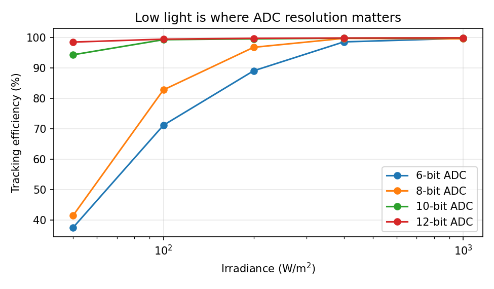

# How many bits does an MPPT controller need?

A follow-up to [pv-mppt-shading](https://github.com/tehreem-gillani/pv-mppt-shading). That project treated voltage and current as exact numbers. A controller on a microcontroller, or a control block on a mixed-signal chip, only sees what its ADC gives it. This study asks how coarse that ADC can be before the tracker starts losing energy.



## Setup

- Same three-module PV string model and the same controllers as the first project (copied into `src/`).
- Every measurement passes through an N-bit ADC model before the controller sees it: 0 to 120 V for voltage, 0 to 10 A for current. The power the controller compares is the product of two integer codes, which is what fixed-point hardware would compute.
- Resolution swept from 4 to 14 bits, with and without sensor noise.

## Results

**Over the full shading sequence**, the event-triggered tracker is already within one percent of its best result at 5 bits, and levels off around 9 to 10 bits:

| Bits | Voltage LSB | Current LSB | Ideal sensors | With noise |
|---|---|---|---|---|
| 4 | 8.0 V | 667 mA | 87.2 % | 86.5 % |
| 6 | 1.9 V | 159 mA | 99.2 % | 98.6 % |
| 8 | 0.47 V | 39 mA | 98.9 % | 99.2 % |
| 10 | 0.12 V | 9.8 mA | 99.3 % | 99.4 % |
| 12 | 0.03 V | 2.4 mA | 99.4 % | 99.4 % |

The reason is the shape of the curve: the top of a P-V peak is flat, so drifting a few volts around the maximum barely changes the power. Coarse quantisation makes P&O wander across that flat top, and wandering there is cheap.

**At low light the picture changes completely.** The current is then a small fraction of the ADC's full scale, so it is represented by only a few codes:

| Irradiance | 6-bit | 8-bit | 10-bit | 12-bit |
|---|---|---|---|---|
| 1000 W/m² | 99.8 % | 99.6 % | 99.9 % | 99.9 % |
| 200 W/m² | 89.1 % | 96.8 % | 99.6 % | 99.8 % |
| 100 W/m² | 71.2 % | 82.8 % | 99.3 % | 99.5 % |
| 50 W/m² | 37.5 % | 41.5 % | 94.4 % | 98.6 % |

(Plain P&O, uniform irradiance, sensor noise on.)

## What this means

The required resolution is set by the dimmest condition you still want to harvest, not by full sun. For this string, 10 bits is enough down to about 100 W/m², and 12 bits extends that to 50 W/m². An 8-bit converter, which looks fine in every bright-sky test, loses about 17 % of the energy at 100 W/m² and more than half at 50 W/m².

A second way out, instead of more bits, would be a current-sense range that switches with irradiance (a programmable-gain stage in front of the ADC). That is the kind of trade-off a mixed-signal designer makes: spend area on ADC bits, or on an analog gain stage.

## Limitations

- The ADC is ideal apart from quantisation: no offset, gain error, or nonlinearity.
- Only the measurement path is quantised. The voltage reference the controller sends to the converter is still a continuous number.
- The heat map in `figures/bits_vs_step.png` (step size against bits, clear sky) came out almost flat, which matches the flat-peak explanation above but is not an interesting figure.

## Running it

```bash
pip install -r requirements.txt
python src/bit_width_study.py
```

## About

Syeda Tehreem Gillani, FAST-NUCES Karachi. AI-based coding assistance was used for parts of the software and the first draft of the text; modelling choices, results and text were checked by me. License: MIT.
